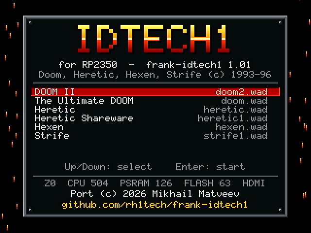
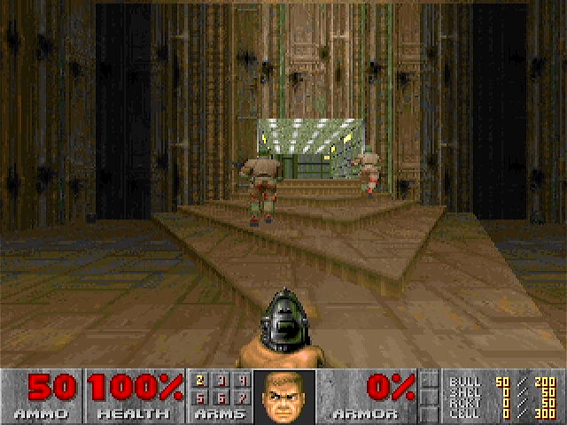
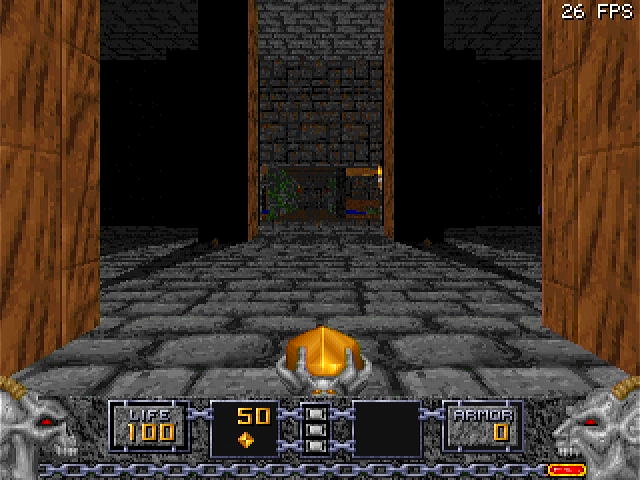
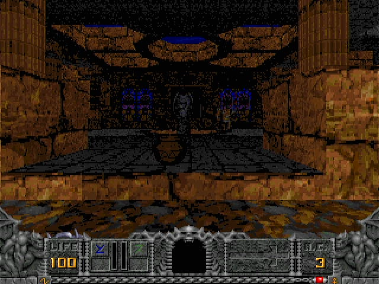
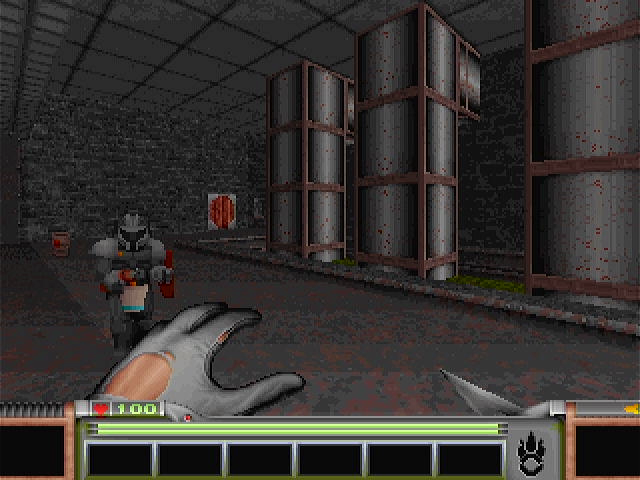
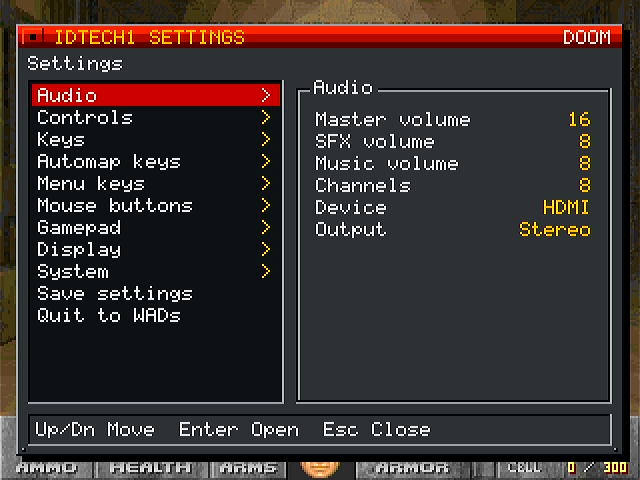
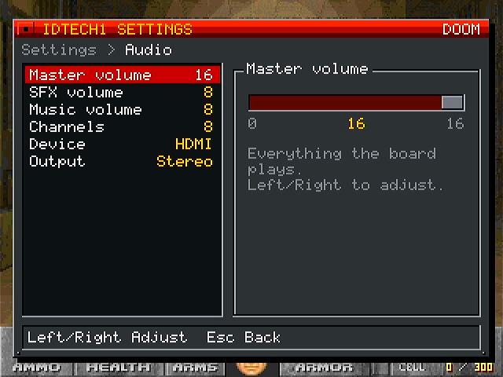
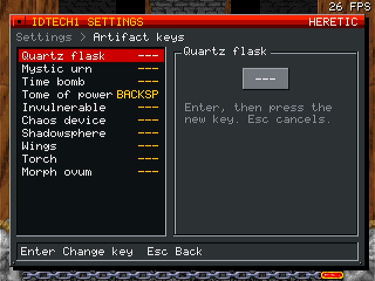

# FRANK idTech1

Official page: **[frank.rh1.tech](https://frank.rh1.tech/)** — hub for all FRANK boards and firmware.

Port of idTech1 games (Doom, Heretic, Hexen, Strife) for Raspberry Pi Pico 2 (RP2350) with HDMI output, SD card, PS/2 or USB keyboard/mouse, and OPL music.

All four game engines are compiled into a single firmware binary. At startup, a WAD selector screen automatically detects available WAD files from the SD card and lets you choose which game to play.

## Screenshots

| WAD selector | Doom II | Heretic |
|:---:|:---:|:---:|
|  |  |  |
| **Hexen** | **Strife** | **Settings (F12)** |
|  |  |  |
| **Settings: a slider** | **Settings: key bindings** | |
|  |  | |

## Supported Games

| Engine | Supported WADs |
|--------|---------------|
| **Doom** | doom.wad, doom2.wad, doom1.wad (shareware), plutonia.wad, tnt.wad |
| **Heretic** | heretic.wad, heretic1.wad (shareware) |
| **Hexen** | hexen.wad, hexdd.wad (Deathkings) |
| **Strife** | strife1.wad, strife0.wad (demo) |

## Supported Boards

This firmware is designed for RP2350-based boards with integrated HDMI, SD card, PS/2 (or USB), and PSRAM:

- **[FRANK](https://rh1.tech/projects/frank?area=about)** -- A versatile development board based on RP Pico 2, HDMI output, and extensive I/O options.
- **[Murmulator](https://murmulator.ru)** -- A compact retro-computing platform based on RP Pico 2, designed for emulators and classic games (M1 and M2 layouts).
- **[Waveshare RP2350-PiZero](https://www.waveshare.com/rp2350-pizero.htm)** (Z0) -- An RP2350B board with HDMI, a micro SD slot, 8 MB PSRAM and a second, "PIO-USB" USB-C socket for the keyboard.
- **[UKTailwind Pico Computer 3](https://github.com/UKTailwind/Pico-Computer-3)** (TW) -- An RP2350B board with HDMI, a micro SD slot, 8 MB PSRAM, a PCM5102A I2S DAC and a four-port USB hub.

All of them provide the necessary peripherals out of the box -- no additional wiring required (the Z0 needs an I2S DAC module for I2S sound; HDMI sound works without one).

## Features

- Single firmware binary with all four id Tech 1 engines
- WAD selector start screen with automatic WAD detection; a WAD can be set to start at boot
- 640x480 HDMI output via PIO (320x240 picture, line-doubled), with **HDMI audio**
- Sound through the HDMI cable or an I2S DAC, switchable in the settings
- Full OPL2 music emulation (EMU8950 with ARM assembly optimizations)
- 8MB QSPI PSRAM support for game data
- SD card support for WAD files and savegames
- PS/2 and USB keyboard and mouse input (USB host on the native USB port; on Z0 on its "PIO-USB" socket, on TW through its USB hub)
- USB gamepads: XInput (Xbox 360/One, F710 in X mode), DualShock 4, DualSense, F710 in D mode, common clones and generic HID pads; analog move, turn and look
- NES/SNES pads on the M2 and Z0 joystick ports (TW: on its EXTERNAL I/O header)
- Keyboard layouts: US, UK, German, French
- F12 (or the pad's Back) settings window in every game, described below
- Board settings in `frank-idtech1.ini` on the SD card; a clock that fails to start reverts to the build's by itself
- Flicker-free screens: double-buffered, flipped and palette-loaded at vertical blank

## Hardware Requirements

- **Raspberry Pi Pico 2** (RP2350) or compatible board
- **8MB QSPI PSRAM** (mandatory!)
- **HDMI connector** (directly connected via resistors, no HDMI encoder needed)
- **SD card module** (SPI mode)
- **PS/2 or USB keyboard and mouse**
- Optional: **I2S DAC module** (e.g., TDA1387 or PCM5102A), if sound should not go through HDMI

### PSRAM Options

FRANK idTech1 requires 8MB PSRAM to run. You can obtain PSRAM-equipped hardware in several ways:

1. **Solder a PSRAM chip** on top of the Flash chip on a Pico 2 clone (SOP-8 flash chips are only available on clones, not the original Pico 2)
2. **Build a [Nyx 2](https://rh1.tech/projects/nyx?area=nyx2)** -- a DIY RP2350 board with integrated PSRAM
3. **Purchase a [Pimoroni Pico Plus 2](https://shop.pimoroni.com/products/pimoroni-pico-plus-2?variant=42092668289107)** -- a ready-made Pico 2 with 8MB PSRAM
4. **Use a [Waveshare RP2350-PiZero](https://www.waveshare.com/rp2350-pizero.htm)** or a **[Pico Computer 3](https://github.com/UKTailwind/Pico-Computer-3)** -- PSRAM on board

## Board Configurations

Four GPIO layouts are supported: **M1**, **M2**, **Z0** and **TW**. On M1/M2 the PSRAM pin is auto-detected based on chip package:
- **RP2350B**: GPIO47 (M1, M2, Z0 and TW)
- **RP2350A**: GPIO19 (M1) or GPIO8 (M2)

### HDMI (via 270 ohm resistors)
| Signal | M1 GPIO | M2, TW GPIO |
|--------|---------|-------------|
| CLK-   | 6       | 12          |
| CLK+   | 7       | 13          |
| D0-    | 8       | 14          |
| D0+    | 9       | 15          |
| D1-    | 10      | 16          |
| D1+    | 11      | 17          |
| D2-    | 12      | 18          |
| D2+    | 13      | 19          |

Z0: the on-board HDMI connector, data pairs on GPIO32-37 and the clock pair on GPIO38/39.

### SD Card (SPI mode)
| Signal  | M1 GPIO | M2 GPIO | Z0 GPIO | TW GPIO |
|---------|---------|---------|---------|---------|
| CLK     | 2       | 6       | 30      | 30      |
| CMD     | 3       | 7       | 31      | 31      |
| DAT0    | 4       | 4       | 40      | 28      |
| DAT3/CS | 5       | 5       | 43      | 33      |

### PS/2 Keyboard
| Signal | M1 GPIO | M2 GPIO | Z0 GPIO | TW GPIO |
|--------|---------|---------|---------|---------|
| CLK    | 0       | 2       | 2       | 2       |
| DATA   | 1       | 3       | 3       | 3       |

### PS/2 Mouse
| Signal | M1 GPIO | M2 GPIO | Z0 GPIO | TW GPIO |
|--------|---------|---------|---------|---------|
| CLK    | 14      | 0       | 0       | 0       |
| DATA   | 15      | 1       | 1       | 1       |

TW has no PS/2 sockets: both ports are on its EXTERNAL I/O header, for a PS/2 adapter.

### I2S Audio
| Signal | M1 GPIO | M2 GPIO | Z0 GPIO | TW GPIO |
|--------|---------|---------|---------|---------|
| DATA   | 26      | 9       | 10      | 22      |
| BCLK   | 27      | 10      | 11      | 10      |
| LRCLK  | 28      | 11      | 12      | 11      |

TW: the on-board PCM5102A and its 3.5 mm jack.

### NES/SNES Pad
| Signal | M2 GPIO | Z0 GPIO | TW GPIO |
|--------|---------|---------|---------|
| CLK    | 20      | 4       | 4       |
| LATCH  | 21      | 7       | 7       |
| DATA   | 26      | 6       | 6       |

Not on M1, whose GPIO14/15 carry the PS/2 mouse.

### USB
- **M1, M2:** the Pico's own USB port is the USB host for keyboards, mice and gamepads (through an OTG adapter or a hub).
- **Z0:** the "PIO-USB" USB-C socket (D+ GPIO28, D- GPIO29) is the USB host. The other socket ("USB") is for power and flashing.
- **TW:** the native USB goes to the on-board four-port hub (the USB-A sockets) or to the micro USB socket, picked by the board's USB switch: hub for play, micro USB for flashing. The "USB CONSOLE" USB-C socket is a CH340C on UART1 (GPIO8/9), used by `-DFRANK_UART_CONSOLE=ON`.

## Building

### Prerequisites

1. Install the [Raspberry Pi Pico SDK](https://github.com/raspberrypi/pico-sdk) (version 2.0+)
2. Set environment variable: `export PICO_SDK_PATH=/path/to/pico-sdk`
3. Install ARM GCC toolchain

### Build Steps

```bash
# Clone the repository
git clone https://github.com/rh1tech/frank-idtech1.git
cd frank-idtech1

# Build for M1 layout (default)
mkdir build && cd build
cmake -DBOARD_VARIANT=M1 ..
make -j$(nproc)

# Build for M2, Z0 or TW
cmake -DBOARD_VARIANT=M2 ..
cmake -DBOARD_VARIANT=Z0 ..
cmake -DBOARD_VARIANT=TW ..
```

### Build Options

| Option | Description |
|--------|-------------|
| `-DBOARD_VARIANT=M1` | M1 GPIO layout (default) |
| `-DBOARD_VARIANT=M2` | M2 GPIO layout |
| `-DBOARD_VARIANT=Z0` | Waveshare RP2350-PiZero |
| `-DBOARD_VARIANT=TW` | UKTailwind Pico Computer 3 |
| `-DCPU_SPEED=504` | CPU clock in MHz: 252 or 504 (HDMI needs a multiple of 252) |
| `-DPSRAM_SPEED=100` | PSRAM speed in MHz |
| `-DFLASH_SPEED=66` | Flash speed in MHz |
| `-DFRANK_Z0_PIO_USB=OFF` | Z0: USB host on the native USB socket instead of the PIO-USB one |
| `-DFRANK_USB_CONSOLE=ON` | Development: the native USB is a serial console (`~BOOT~` reboots into BOOTSEL) instead of the USB host |

Or use the build script (builds M1 by default):

```bash
./build.sh
```

### Release Builds

To build all variants with version numbering:

```bash
./release.sh
```

This creates versioned UF2 files in the `release/` directory:
- `frank-idtech1_m1_X_XX.uf2` (504 MHz CPU, 100 MHz PSRAM)
- `frank-idtech1_m2_X_XX.uf2` (504 MHz CPU, 100 MHz PSRAM)
- `frank-idtech1_z0_X_XX.uf2` (504 MHz CPU, 133 MHz PSRAM, USB on the PIO-USB socket)
- `frank-idtech1_tw_X_XX.uf2` (504 MHz CPU, 133 MHz PSRAM, USB through the on-board hub)

### Flashing

```bash
# With device in BOOTSEL mode:
picotool load -v -x build/frank-idtech1.uf2
```

Or copy the UF2 file to the `RP2350` drive that appears in BOOTSEL mode.

The USB port is the keyboard/mouse host (on M1/M2), so the firmware has no USB
serial console and `picotool -f` cannot reboot it: hold BOOTSEL while
resetting or powering up.

## SD Card Setup

1. Format an SD card as FAT32
2. Place WAD files in an `idtech1` folder
3. The WAD selector will automatically detect all supported WADs at startup
4. Save directories are created automatically per game

The settings window saves each game's settings to its own config file, and
the board's settings to `frank-idtech1.ini` at the root of the card:

| Key | Values | Meaning |
|-----|--------|---------|
| `cpu_mhz` | 0 (build), 252, 504 | CPU clock |
| `psram_mhz` | 0 (build), 84, 100, 133, 166 | PSRAM clock |
| `shift_x`, `shift_y` | -32..32 | Picture shift |
| `keyboard` | 0 US, 1 UK, 2 German, 3 French | Keyboard layout |
| `autostart` | a WAD file name, or empty | WAD to start at boot |
| `audio` | `i2s`, `hdmi` | Sound output |
| `clock_try` | 0, 1 | Set while trying new clocks; a boot that doesn't reach the WAD selector goes back to the build's clocks |

### Where to Get WAD Files

**Shareware / Free:**
- **Doom Shareware** (`doom1.wad`): [Internet Archive](https://archive.org/details/DoomsharewareEpisode)
- **Heretic Shareware** (`heretic1.wad`): [Internet Archive](https://archive.org/details/Heretic_Shareware)
- **Strife Demo** (`strife0.wad`): [Internet Archive](https://archive.org/details/StrifeDemo)

**Full versions** can be purchased from [Steam](https://store.steampowered.com/) or [GOG](https://www.gog.com/):
- [The Ultimate Doom](https://store.steampowered.com/app/2280/Ultimate_Doom/)
- [Doom II](https://store.steampowered.com/app/2300/DOOM_II/)
- [Final Doom](https://store.steampowered.com/app/2290/Final_DOOM/)
- [Heretic: Shadow of the Serpent Riders](https://store.steampowered.com/app/2390/Heretic_Shadow_of_the_Serpent_Riders/)
- [Hexen: Beyond Heretic](https://store.steampowered.com/app/2360/HeXen_Beyond_Heretic/)
- [Hexen: Deathkings of the Dark Citadel](https://store.steampowered.com/app/2370/HeXen_Deathkings_of_the_Dark_Citadel/)
- [Strife: Veteran Edition](https://store.steampowered.com/app/317040/The_Original_Strife_Veteran_Edition/)

## Controls

### WAD Selector

| Key | Action |
|-----|--------|
| Up / Down, W / S | Select a WAD |
| PgUp / Home, PgDn / End | First / last WAD |
| Enter, Space | Start |
| Any key during the countdown | Stay in the list instead of starting the "start at boot" WAD |

### Keyboard (defaults; every key can be changed in F12 > Keys)

| Key | Doom | Heretic | Hexen | Strife |
|-----|------|---------|-------|--------|
| Arrows | Move / turn | Move / turn | Move / turn | Move / turn |
| , / . | Strafe left / right | Strafe | Strafe | Strafe |
| Right Ctrl | Fire | Fire | Fire | Fire |
| Space | Use / open | Use | Use | Use |
| Right Alt | Strafe on | Strafe on | Strafe on | Strafe on |
| Right Shift | Run | Run | Run | Run |
| 1-8 | Weapons | Weapons | Weapons | Weapons |
| Tab | Automap | Automap | Automap | Automap |
| PgUp / Ins / Home | | Fly up / down / center | Fly up / down / center | |
| PgDn / Del / End | | Look up / down / center | Look up / down / center | Look up / down |
| [ / ] | | Inventory left / right | Inventory left / right | Inventory left / right |
| Enter | | Use artifact | Use artifact | Use item |
| Backspace | | Tome of power | Use all artifacts | Drop item |
| / | | | Jump | Jump |
| 5-0, \\ | | | Artifact hot keys | |
| H / Q / W | | | | Use health / query / mission |
| Esc | Menu | Menu | Menu | Menu |
| F1-F11 | Help, save, load, volume, detail, quick save, end game, messages, quick load, quit, gamma | same | same | same |
| - / = | Smaller / bigger view | same | same | same |
| Pause | Pause | Pause | Pause | Pause |
| **F12** | **Settings window** | same | same | same |

Automap: - / = zoom, 0 whole map, F follow, G grid, M mark, C clear marks.

### Mouse

- Move left/right: turn; forward/back: move (unless "No vertical" is on)
- Left button: fire; right button: strafe on; middle button: move forward (rebindable in F12 > Mouse buttons)

### Gamepad

- Left stick: move and strafe; right stick: turn and look (swappable)
- D-pad: arrow keys; Start: game menu; Back: settings window
- RT fire, A use, LT run, LB/RB previous/next weapon, Y automap, B jump (Hexen/Strife), X use artifact (rebindable in F12 > Gamepad > Buttons)
- In the game's menu: A / RT select, B back, Y / X answer yes / no
- In the WAD selector and the settings window: A / RT / Start select, B back, LB / RB page up / down
- NES/SNES pad: D-pad moves, NES A / SNES B fire, NES B / SNES Y use, SNES A run, SNES X automap, L/R weapons, Start menu, Select settings

## Settings Window (F12)

F12 (or a gamepad's Back / Select) opens the settings window over any game.
Up/Down move, Enter or Right opens a group, Left/Right change a value, Enter
runs an action, Esc goes back and closes; a letter jumps to the next row
starting with it. Changes apply at once; **Save settings** writes them to
the SD card. Rows that don't apply to the running game are hidden.

| Group | Setting | Values |
|-------|---------|--------|
| **Audio** | Master volume | 0-16, everything the board plays |
| | SFX volume, Music volume | 0-15 |
| | Voice volume | 0-15 (Strife) |
| | Channels | 1-16 sounds at once (from the next game start) |
| | Device | I2S (DAC module) or HDMI (44.1 kHz), from the next start |
| | Output | Stereo, Swapped, Mono |
| **Controls** | Mouse speed | 0-9 |
| | Mouse scale | 1-8 mouse counts per game unit |
| | Acceleration | 10-40 (10 off, 20 doubles fast movements) |
| | Accel. from | 0-32, the speed where acceleration starts |
| | Invert X, Invert Y | On/Off |
| | No vertical | The mouse only turns |
| | Always run | On/Off |
| | Double-click | Double-click forward or strafe to use |
| | Keyboard | US, UK, German, French |
| **Keys** | Movement, fire, use, strafe, run, jump, fly, look, inventory, items, weapons 1-8, previous/next weapon, pause | Enter, then press the new key; Esc cancels. A key already in use moves to the old one's place |
| **Artifact keys** | Heretic and Hexen artifact hot keys | |
| **Automap keys** | Automap, zoom in/out, whole map, follow, grid, mark, clear marks | |
| **Menu keys** | Help, save, load, volume, detail, quick save, end game, messages, quick load, quit, gamma, bigger/smaller view | |
| **Mouse buttons** | Fire, strafe on, forward, backward, run, use, jump, previous/next weapon, inventory, use artifact | None, Left, Right, Middle |
| **Gamepad** | Buttons | A pad button for each action |
| | Analog | Off: the sticks act like the D-pad |
| | Turn speed, Move speed, Look speed | 0-20 |
| | Dead zone | 0-50 % |
| | Invert look, Swap sticks | On/Off |
| **Display** | Screen size | 3-11 |
| | Detail | High, Low (Doom) |
| | Gamma | Off, levels 1-4 |
| | Messages | On/Off |
| | Dialog text | On/Off (Strife) |
| | FPS counter | On/Off |
| | Shift X, Shift Y | -32..32 pixels, for a TV that cuts the edges off |
| **System** | CPU | Build, 252 MHz, 504 MHz (from the next start) |
| | PSRAM | Build, 84, 100, 133, 166 MHz (from the next start) |
| | Start at boot | Start the running WAD at boot; a key within 3 s shows the list |
| **Save settings** | | Writes the game's config file and `frank-idtech1.ini` |
| **Quit to WADs** | | Back to the WAD selector (asks first) |

A CPU or PSRAM clock that doesn't work doesn't lock the board out: if the
board doesn't reach the WAD selector with it, the next start goes back to the
build's clocks.

## License

GNU General Public License v2. See [LICENSE](LICENSE) for details.

This project is based on:
- [Chocolate Doom](https://www.chocolate-doom.org/) (Doom, Heretic, Hexen, and Strife source ports)
- [doomgeneric](https://github.com/ozkl/doomgeneric) by ozkl
- [rp2040-doom](https://github.com/kilograham/rp2040-doom) by Graham Sanderson (OPL and Pico optimizations)
- [EMU8950](https://github.com/digital-sound-antiques/emu8950) by Mitsutaka Okazaki (OPL2 emulator)
- [Pico-PIO-USB](https://github.com/sekigon-gonnoc/Pico-PIO-USB) by sekigon-gonnoc (USB host on PIO, MIT)
- HDMI data island packets from [pico_hdmi](drivers/hdmi/LICENSE.pico_hdmi) (public domain)
- Gamepad drivers from pico-speccy, NES/SNES pad driver from murmgenesis

## Author

Mikhail Matveev <xtreme@rh1.tech>

## Acknowledgments

- id Software for the Doom engine
- Raven Software for Heretic and Hexen
- Rogue Entertainment for Strife
- The Chocolate Doom team for the clean portable source ports
- Graham Sanderson for the incredible RP2040 optimizations and EMU8950 ARM assembly
- The Raspberry Pi foundation for the RP2350 and Pico SDK
